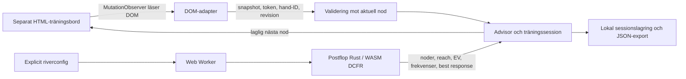

# Arkitektur

Version 1.3 kopplar `LivePanel` till `src/decision/`: snapshots → kontext och
heltalsadapter → avbrytbar MCCFR-worker → kvalitetsgrind → `DecisionAdvisor`.
En separat HU-riverworker kan uppgradera svaret efter exploaterbarhetskontroll
och kontroll av hela bettingträdet. Experimentresultat visas bara efter aktivt
val. Den generella strategikvaliteten har inte godkänts; se
[kvalitetsrapporten](decision-engine.md). Avläsning och snapshotkontrakt ändras inte.

Version 1.1 lägger till en separat liveväg: Edge DOM-observer → autentiserad HTTP på endast 127.0.0.1 → validerad snapshot i mainprocessen → `poker://app/live-state` → LivePanel → egen WASM-worker. Renderer har fortsatt ingen extern nätverksåtkomst. Servern accepterar bara parningskod och rätt pokerorigin; storlek, tid, sekvens och schema kontrolleras. Token lagras lokalt i appprofilen. Liveinnehåll sparas inte som träningsbeslut. Se [begränsningar och verifiering](live.md).

## Gränser

`src/core/config.ts` är ingången för egna scenarier. Den begränsar siffror, kort, range-text, betstorlekar och iterationsbudget innan TOML genereras. Rusts egen parser avvisar ogiltig rangesyntax och tomma/blockerade ranges. `tree_stats` sätter ett minnestak på 64 MiB CFR-lagring och högst 250 noder före solve.

`public/solver-engine.js` är en liten adapter till den oförändrade WASM-motorn. Solvern ägs av en worker. Huvudtråden förblir responsiv, kan visa progress och avbryter genom att terminera workern. Varje ny solve får sin egen worker; sena svar kan inte överskriva aktuell studie. LRU-lik cache på åtta explicit konfigurationsnycklar minskar återkommande väntan. Iterationsgräns 100–5 000 och väggtidstak 60 sekunder skyddar användarflödet.

Varje nod innehåller lagliga handlingar, aktuell pott, återstående stackar samt verkliga handfrekvenser och EV. EV per handling kommer från barnnoden med solverns fortsättningsstrategi; det är inte allmän strategioberoende EV. Uniform strategi för noll-räckvidd presenteras aldrig som råd.

`src/table/main.tsx` äger ett separat DOM-dokument i en iframe. Den tar emot en begränsad nodelayout utan strategitabeller. `dom-adapter.ts` läser tillbaka de faktiska elementen och publicerar snapshots. Den läser inte React-state. Dolda kort filtreras över hela elementets föräldrakjedja. Historiken läses ur en explicit ordnad lista.

`src/App.tsx` matchar iframe-window, origin, token, hand-ID, revision, exakt konfigurationsnyckel, nod-ID, hero och hålkort. `validateSnapshot` jämför bräda, pott och stackar med solverns aktuella nod och kontrollerar format och tid. Efter 3,5 sekunder utan ny snapshot döljs råd; valideraren avvisar snapshots äldre än fyra sekunder. När en handling eller studie ändras släcks råden tills den nya noden avlästs.

Motståndaren spelar en rangevägd mix av nodens strategier efter hero-blockering. Någon dold faktisk motståndarhand eller fiktivt resultat skapas inte. Framsteg mäter beslut och deras mix/EV, inte vunna pengar.

## Windows och data

Electron serverar bara paketerade statiska filer via `poker://app`. Path confinement skyddar filserveringen. `standard` och `secure` registreras före `app.ready`; origin och sessionsnycklar behålls vid omstart. Renderer har sandbox, context isolation, webSecurity och saknar Node, preload eller generell IPC. Externa nätverksprotokoll, nya fönster, webviews och permissions blockeras. CSP tillåter lokal JS, WASM och lokala typsnitt; inga fjärrskript används.

Sessionen lagras i Electrons användarprofil, vanligtvis under `%APPDATA%/Poker GTO Advisor/`. Skrivfel rapporteras. Import max 3 MB/1 000 beslut valideras innan merge, med ID-deduplicering. Nollställning kräver en framgångsrik lokal backup och kan återställas även om filhämtningen avbryts.

## Reproducerbarhet och tester

`package-lock.json` låser npm-beroenden. `docs/solver-provenance.json` låser runtime-hasharna och markerar att ingen egen Rust-build utfördes. Den granskade upstreamkällan finns under `vendor/postflop` med Cargo.lock. För egen återkompilering: installera Rust stable och wasm-pack och kör `wasm-pack build wasm --target web --release --out-dir pkg` i den katalogen; ersätt båda runtimefilerna tillsammans och kör alla verifieringar igen.

Domäntester och workerfeltester finns i `tests/`. `scripts/verify-solver.mjs` kör riktig WASM och en oberoende, långsam 5-av-7-handvärderare plus scalar best response i `scripts/river-oracle.mjs`. `electron/smoke.cjs` testar faktisk Windowsruntime i separat profil och sparar visuella bevis, utan att skriva testdata till användarens vanliga träningssession.
